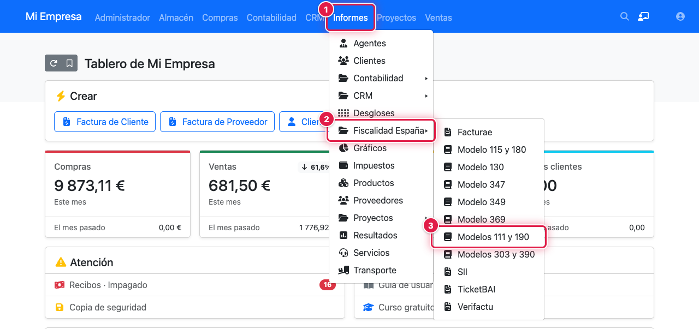
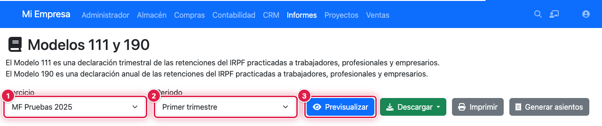
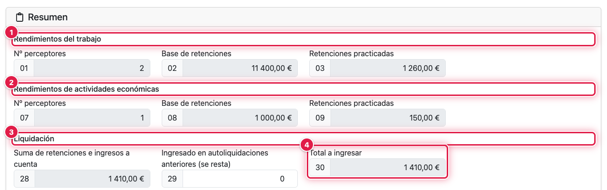
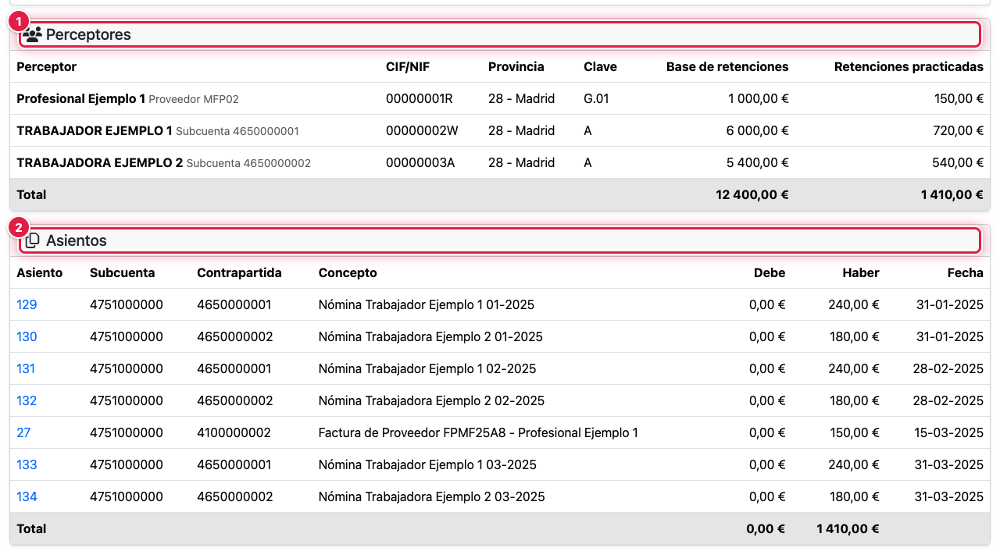
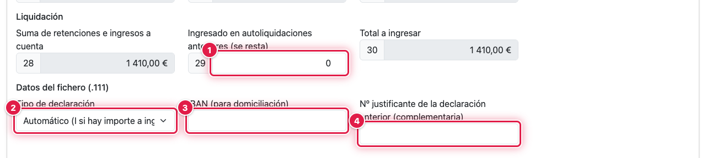
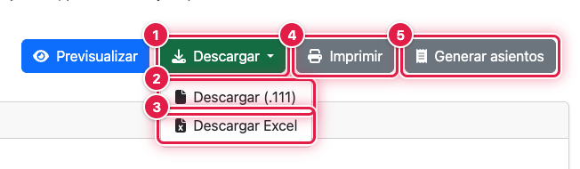
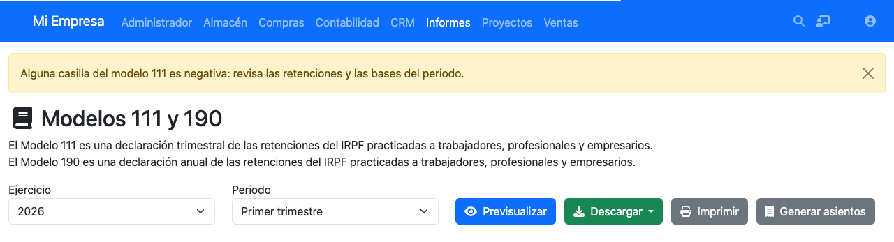

El Modelo 111 es una declaración trimestral de las retenciones del IRPF practicadas a trabajadores, profesionales y empresarios. El programa lo calcula a partir de tu contabilidad, rellena las casillas oficiales, genera el fichero para presentarlo en la AEAT y crea los asientos del pago.

## 👥 ¿Quién tiene que presentarlo?

Tienes que presentarlo cada trimestre si has practicado retenciones del IRPF en:

- Nóminas y finiquitos de tus trabajadores.
- Facturas de profesionales, como el asesor, un abogado o un diseñador.
- Actividades agrícolas, ganaderas y forestales.
- Actividades intelectuales, como cursos, conferencias o derechos de autor.

⚠️ Las retenciones de los alquileres no van en el Modelo 111, sino en el Modelo 115. Para que el programa las deje fuera del cálculo, asigna la cuenta especial **IRPFA** a la subcuenta de retenciones de alquileres o a su cuenta.

## ⚙️ Antes de empezar

Las retenciones se leen de la contabilidad, así que las nóminas y las facturas de compra con retención tienen que estar ya contabilizadas en el trimestre. Si no ves el menú del paso 3, activa el plugin Modelo111 desde **menú Administrador** → **Plugins**.

## 📋 Cómo se rellena

1. Pulsa el menú **Informes**.
2. Pasa el ratón por **Fiscalidad España**.
3. Elige **Modelos 111 y 190**.

Ahora elige qué declaración quieres ver:

1. Elige el **Ejercicio**. La lista agrupa los ejercicios por empresa.
2. Elige el **Periodo**: **Primer trimestre**, **Segundo trimestre**, **Tercer trimestre** o **Cuarto trimestre**. Al abrir la pantalla aparece el trimestre en curso.
3. Pulsa **Previsualizar**.

Si el periodo no tiene retenciones, la pantalla muestra el aviso **Sin datos**.

### Las casillas

El **Resumen** repite las casillas del modelo oficial. Los rendimientos del trabajo, las nóminas, van a las casillas 01 a 03 (1) y los de actividades económicas, como las facturas de profesionales, a las casillas 07 a 09 (2). Las casillas de premios (13-15), ganancias forestales (19-21) y cesión de derechos de imagen (25-27) solo aparecen si tienen datos. La **Liquidación** (3) suma las retenciones y da el **Total a ingresar** (4), la casilla 30.

Si hay sueldos en asientos con varios perceptores sin contrapartida, aparece un aviso: esos sueldos se suman a la base de los rendimientos del trabajo, pero no a ningún perceptor.

### El detalle y los asientos

Debajo del resumen están los **Perceptores** (1), con su NIF, provincia, clave, base y retención, y los **Asientos** (2) de donde salen las retenciones, con los totales del debe y del haber. Pulsa el número de un asiento para abrirlo.

Para saber cómo se obtiene cada importe, lee [Cómo se calcula el Modelo 111](como-se-calcula-el-modelo-111.md).

## 📤 Presentar en la AEAT

Antes de descargar el fichero, revisa los datos de la parte inferior del **Resumen**:

1. **Ingresado en autoliquidaciones anteriores (se resta)**: la casilla 29. Déjala en 0 salvo que ya hayas ingresado algo de este trimestre. Escribe el importe en positivo (si escribes un número negativo, el programa lo pone a 0 y te avisa) y pulsa **Previsualizar** para recalcular el total.
2. **Tipo de declaración**: por defecto es **Automático (I si hay importe a ingresar, N si no)**. También puedes elegir **I - Ingreso**, **U - Domiciliación**, **G - Ingreso a anotar en la cuenta corriente tributaria** o **N - Negativa**.
3. **IBAN (para domiciliación)**: obligatorio solo con el tipo **U - Domiciliación**.
4. **Nº justificante de la declaración anterior (complementaria)**: son 13 cifras y es obligatorio si hay algo en la casilla 29.

Después, con el periodo ya previsualizado:

1. Pulsa **Descargar** (1).
2. Elige **Descargar (.111)** (2) para obtener el fichero de presentación, con el nombre `NIF_año_periodo.111`, por ejemplo `NIF_2025_1T.111`. Súbelo en la presentación del Modelo 111 por fichero de la sede electrónica de la AEAT.

La otra opción del menú es **Descargar Excel** (3): una tabla con los asientos de las retenciones y sus totales, útil para revisarlos o enviársela al asesor. Ese fichero no incluye las casillas.

Los botones **Imprimir** (4) y **Generar asientos** (5) están en la misma fila. **Imprimir** abre en otra pestaña un PDF con el resumen, las casillas de cada grupo y los asientos.

Los botones **Descargar**, **Imprimir** y **Generar asientos** solo aparecen cuando el periodo tiene datos. **Generar asientos** solo está en los trimestres: el periodo anual (Modelo 190) es informativo y no se ingresa.

### Si no se genera el fichero

El programa no genera el fichero .111 y muestra un aviso cuando falta algo o no cuadra. Corrígelo y vuelve a descargarlo:

- **El NIF de la empresa no es válido.** Corrígelo en los datos de la empresa.
- **Alguna casilla del modelo 111 es negativa: revisa las retenciones y las bases del periodo.** Pasa, por ejemplo, cuando una factura rectificativa de un profesional deja el periodo en negativo.
- **El resultado a ingresar es negativo: el modelo 111 no admite resultados negativos.**
- **Para domiciliar el pago (tipo U) hay que indicar el IBAN.**
- **Una declaración negativa (tipo N) no puede tener importe a ingresar.**
- **Hay importes ingresados en autoliquidaciones anteriores: es una complementaria y hay que indicar el nº de justificante (13 cifras) de la declaración anterior.**

El fichero .111 es solo para los trimestres: en el periodo anual el programa no ofrece **Descargar (.111)**, porque ese periodo es del Modelo 190.

## 🧾 Contabilizar el pago

Cuando hayas presentado el modelo, pulsa **Generar asientos** en un trimestre con **Total a ingresar** mayor que cero. El programa crea dos asientos con fecha de hoy:

1. **Obligación de pago**, con el concepto `Modelo 111 T1 2025 - Obligación`: debe en la subcuenta 465 (remuneraciones pendientes de pago) y haber en la 4751 (Hacienda pública, acreedora por retenciones).
2. **Pago**, con el concepto `Modelo 111 T1 2025 - Pago`: debe en la 4751 y haber en la 572 (bancos).

Si ya existe un asiento con el mismo concepto en el ejercicio, el programa no lo duplica y te avisa con **Ya existe un asiento en el ejercicio...**. Estos asientos no se tienen en cuenta cuando vuelves a calcular el modelo.

## 🔧 Si algo no coincide

- Cambia los datos desde la contabilidad (asientos o facturas) o desde los datos del perceptor y pulsa **Previsualizar** de nuevo: el cálculo se rehace cada vez.
- Si falta una retención, comprueba que el asiento está en las fechas del trimestre y que usa la subcuenta de retenciones practicadas (4751).

## Ver también

- [Cómo se calcula el Modelo 111](como-se-calcula-el-modelo-111.md)
- [Cómo hacer el Modelo 190](como-hacer-el-modelo-190.md)
- [API REST de los modelos 111 y 190](../Dev/api-modelos-111-190.md)
