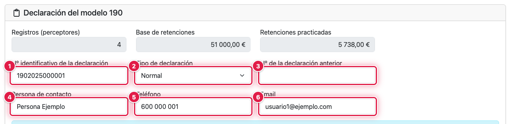
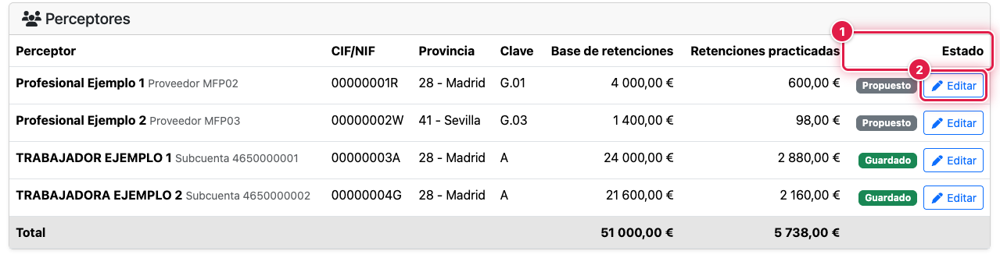
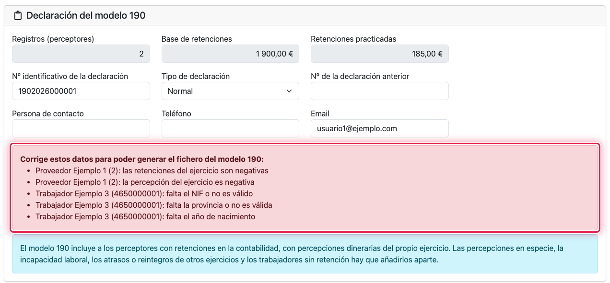
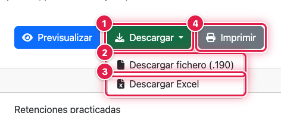

El Modelo 190 es una declaración anual de las retenciones del IRPF practicadas a trabajadores, profesionales y empresarios: resume, perceptor a perceptor, lo que has pagado y lo que has retenido durante el año. El programa lo calcula con la misma contabilidad que el Modelo 111 y genera el fichero oficial para presentarlo en la AEAT, pero no lo hace mientras falte algún dato: la propia pantalla te dice qué corregir.

## 👥 ¿Quién tiene que presentarlo?

Tienes que presentarlo una vez al año si has practicado retenciones del IRPF en:

- Nóminas y finiquitos de tus trabajadores.
- Facturas de profesionales, como el asesor, un abogado o un diseñador.
- Actividades agrícolas, ganaderas y forestales.
- Actividades intelectuales, como cursos, conferencias o derechos de autor.

⚠️ Las retenciones de los alquileres no van en el Modelo 190, sino en el Modelo 180. Para que el programa las deje fuera del cálculo, asigna la cuenta especial **IRPFA** a la subcuenta de retenciones de alquileres o a su cuenta.

## 📋 Cómo se rellena

1. Abre **menú Informes** → **Fiscalidad España** → **Modelos 111 y 190**, como en [Cómo hacer el Modelo 111](como-hacer-el-modelo-111.md).
2. Elige el **Ejercicio**.
3. En **Periodo**, elige **Anual (Modelo 190)**.
4. Pulsa **Previsualizar**.

La pantalla muestra la **Declaración del modelo 190**: el número de **Registros (perceptores)**, la **Base de retenciones** y las **Retenciones practicadas** del año. Debajo están los datos de la declaración que el fichero necesita (1 a 6):

- **Nº identificativo de la declaración** (1): son 13 cifras y empiezan por 190. El programa propone `190`, el año y `000001`.
- **Tipo de declaración** (2): **Normal**, **Complementaria** o **Sustitutiva**.
- **Nº de la declaración anterior** (3): solo en las declaraciones complementarias o sustitutivas, con 13 cifras.
- **Persona de contacto** (4), **Teléfono** (5) y **Email** (6): el programa propone los de la empresa. Cámbialos si presenta otra persona.

Estos datos no se guardan: se usan al descargar el fichero, así que revísalos cada vez que lo generes.

### Los perceptores

Bajo la declaración, el listado de **Perceptores** muestra de cada uno su NIF, provincia, **Clave**, base y retenciones. La columna **Estado** (1) indica si sus datos están listos:

- **Propuesto**: el programa ha propuesto los datos a partir del proveedor o del ejercicio anterior, y nadie los ha guardado todavía.
- **Guardado**: los datos del perceptor están guardados en este ejercicio.
- **Faltan datos**: hay algo que impide generar el fichero.

El botón **Editar** (2) abre la ventana con los datos del modelo 190 de ese perceptor. Cómo rellenarla se explica en [Datos de los perceptores del Modelo 190](datos-de-los-perceptores-del-modelo-190.md).

### Qué datos faltan

Si hay algo mal, aparece un recuadro rojo con el título **Corrige estos datos para poder generar el fichero del modelo 190:**. Cada línea indica el perceptor, con su código entre paréntesis, y el problema.

Estos son los avisos posibles y cómo se arreglan:

- **Falta el NIF o no es válido**, **falta el nombre**, **falta la provincia o no es válida**, **la clave de percepción no es válida**, **la subclave no es válida para la clave** (letra) y **falta el año de nacimiento** (claves A, B y C): corrígelos con **Editar** en ese perceptor.
- **Con la situación familiar 2 hay que indicar el NIF del cónyuge**: también con **Editar**.
- **Las retenciones del ejercicio son negativas** y **la percepción del ejercicio es negativa**: el fichero no admite importes negativos. Revisa en la contabilidad las facturas rectificativas o los asientos de regularización de ese perceptor.
- **El nº identificativo de la declaración debe tener 13 cifras y empezar por 190**, y **en una declaración complementaria o sustitutiva hay que indicar el nº de la declaración anterior (13 cifras)**: corrígelos en los datos de la declaración.
- **El NIF de la empresa no es válido**: corrígelo en los datos de la empresa.

Debajo, un recuadro azul recuerda lo que el modelo no incluye: las percepciones en especie, la incapacidad laboral, los atrasos o reintegros de otros ejercicios y los trabajadores sin retención. Si los tienes, añádelos aparte al presentar.

## 📤 Presentar en la AEAT

Cuando no queden avisos y hayas pulsado **Previsualizar**:

1. Pulsa **Descargar** (1).
2. Elige **Descargar fichero (.190)** (2). Se descarga el fichero con el nombre `NIF_año.190`, por ejemplo `NIF_2025.190`.
3. Súbelo en el trámite de presentación del Modelo 190 por fichero de la sede electrónica de la AEAT.

La otra opción es **Descargar Excel** (3), una tabla con los asientos de las retenciones y sus totales, para revisarlos. El botón **Imprimir** (4) abre en otra pestaña un PDF con el resumen, los perceptores con su NIF, provincia y clave, y los asientos.

Si pulsas **Descargar fichero (.190)** y faltan datos, el programa no genera el fichero: muestra el aviso **No se ha generado el fichero del modelo 190 porque faltan o son incorrectos algunos datos.** seguido de cada dato por corregir. Si necesitas cambiar algo, corrígelo en el programa, pulsa **Previsualizar** y vuelve a descargar el fichero.

El fichero .190 solo se genera en el periodo anual. En los trimestres se descarga el fichero del Modelo 111. El Modelo 190 no se ingresa, así que en el periodo anual no está el botón **Generar asientos**: los asientos de pago se generan desde cada trimestre del Modelo 111.

## Ver también

- [Datos de los perceptores del Modelo 190](datos-de-los-perceptores-del-modelo-190.md)
- [Cómo hacer el Modelo 111](como-hacer-el-modelo-111.md)
- [API REST de los modelos 111 y 190](../Dev/api-modelos-111-190.md)
