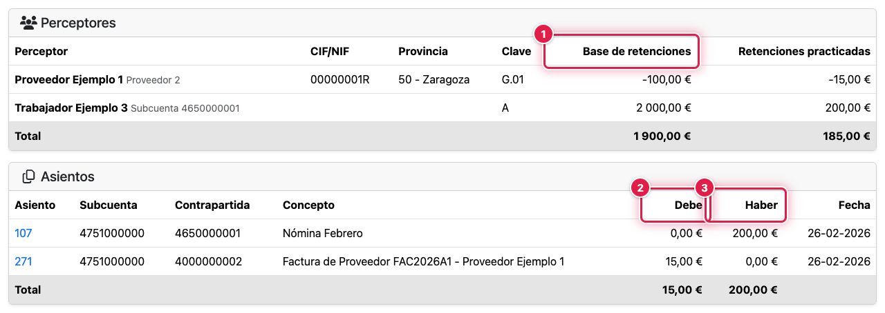

El programa calcula los modelos 111 y 190 leyendo los asientos de tu contabilidad: no hay que introducir nada aparte. Esta página explica de dónde sale cada importe, para que sepas qué revisar cuando una cifra no es la que esperabas.

## 📚 Qué asientos se leen

Se leen las partidas del periodo de las subcuentas de retenciones practicadas:

- Las subcuentas de la cuenta especial **IRPFPR**, que normalmente es la 4751.
- Las subcuentas que usan las retenciones de las compras.

No se incluyen:

- Las retenciones de ventas (la 473), porque son retenciones que te practican tus clientes.
- Las retenciones de alquileres, si has asignado la cuenta especial **IRPFA** a su subcuenta o a su cuenta: van en el Modelo 115 y en el Modelo 180.
- Los asientos de obligación y de pago que crea el propio programa con **Generar asientos**.

El periodo de cada trimestre son sus tres meses del año del ejercicio. El periodo **Anual (Modelo 190)** es el año completo.

## ➕ Retenciones y bases netas

Los importes son netos, es decir, descuentan lo que se ha revertido:

- El **haber** de la 4751 suma una retención.
- El **debe** de la 4751 resta cuando revierte una retención: en los asientos de facturas de compra rectificativas y en los que tienen alguna partida de gastos (grupo 6), como la regularización de una nómina.
- El debe de la 4751 de los **pagos o liquidaciones** de las retenciones, los asientos sin gastos, no resta, y su contrapartida no cuenta como perceptor.

La base también es neta. En una factura de compra es el neto de sus líneas con IRPF. En una nómina son los sueldos (subcuenta 640): debe menos haber.

En el ejemplo, la **Base de retenciones** (1) del profesional sale negativa porque su factura es una rectificativa: lleva la retención al **Debe** (2) de la 4751 y resta. La nómina, en cambio, la lleva al **Haber** (3) y suma.

⚠️ Si el total de un grupo de casillas queda negativo, el programa no genera el fichero .111, y si la base o la retención de un perceptor queda negativa, no genera el .190. En los dos casos avisa: corrige o regulariza en la contabilidad lo que corresponda y vuelve a previsualizar.

## 🧑‍💼 Quién es el perceptor

Cada retención se asigna a un perceptor:

- En una **factura de compra**, es su proveedor.
- En los asientos **sin factura**, como las nóminas, es la subcuenta de la contrapartida de la retención, por ejemplo una 465 por cada trabajador. Los sueldos (640) del asiento se asignan al perceptor de su contrapartida o, si no tienen contrapartida, al único perceptor del asiento.

Si hay sueldos en un asiento con varios perceptores y sin contrapartida, no se pueden asignar a nadie. Se suman a la base de los rendimientos del trabajo, pero no a ningún perceptor, y la pantalla lo avisa.

## 🔑 La clave decide la casilla

Cada perceptor tiene una clave del Modelo 190 que decide en qué casillas del Modelo 111 va:

| Clave | Casillas del Modelo 111 |
|---|---|
| A a F (trabajo) | 01, 02 y 03: **Rendimientos del trabajo** |
| G, H e I (actividades) | 07, 08 y 09: **Rendimientos de actividades económicas** |
| K, salvo la subclave 02 (premios) | 13, 14 y 15: **Premios** |
| K.02 (aprovechamientos forestales) | 19, 20 y 21: **Ganancias por aprovechamientos forestales** |
| J (derechos de imagen) | 25, 26 y 27: **Cesión de derechos de imagen** |

Las casillas 13 a 27 solo aparecen en la pantalla si tienen datos. Las rentas exentas (clave L) no van al Modelo 111.

El programa propone la clave de cada perceptor: a los profesionales según su porcentaje de retención (15 % o 19 %: **G.01**; 7 %: **G.03**; 2 %: **H.01**; 1 %: **H.04**) y a las nóminas, la **A**. Puedes cambiarla en los datos de cada perceptor, como se explica en [Datos de los perceptores del Modelo 190](datos-de-los-perceptores-del-modelo-190.md).

## 🧮 La liquidación

- Casilla **28**, **Suma de retenciones e ingresos a cuenta**: la suma de las retenciones de todos los grupos.
- Casilla **29**, **Ingresado en autoliquidaciones anteriores (se resta)**: la escribes tú, en positivo, si ya has ingresado algo de ese trimestre.
- Casilla **30**, **Total a ingresar**: la casilla 28 menos la 29.

## 📌 Lo que el modelo no calcula

El programa solo declara las percepciones dinerarias del propio ejercicio de perceptores con retenciones en la contabilidad. Los trabajadores sin retención, las percepciones en especie, la incapacidad laboral y los atrasos o reintegros de otros ejercicios hay que añadirlos aparte.

## Ver también

- [Cómo hacer el Modelo 111](como-hacer-el-modelo-111.md)
- [Cómo hacer el Modelo 190](como-hacer-el-modelo-190.md)
- [Datos de los perceptores del Modelo 190](datos-de-los-perceptores-del-modelo-190.md)
