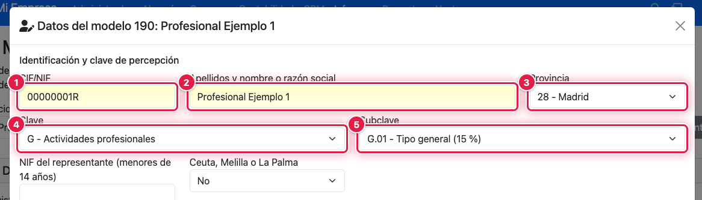
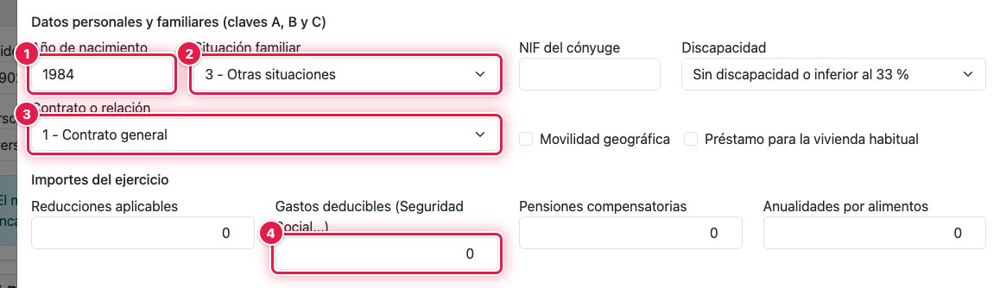
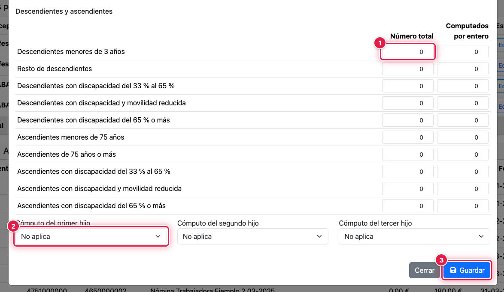

El fichero del Modelo 190 necesita de cada perceptor, trabajador o profesional, datos que la contabilidad no siempre tiene: su NIF, su provincia, la clave de percepción y, en las nóminas, su situación personal y familiar. Esta página explica cómo revisarlos y guardarlos con el botón **Editar** del listado de perceptores.

## 📋 De dónde salen los datos

Al previsualizar el periodo anual, el programa propone los datos de cada perceptor y los marca con el estado **Propuesto**:

- **Proveedores con factura de compra**: el NIF, la razón social y la provincia, que sale de las dos primeras cifras del código postal de su dirección (el código 387 corresponde a la isla de La Palma). Si la dirección no es de España o no tiene código postal, la provincia queda vacía y tienes que elegirla.
- **Nóminas**: el nombre de la subcuenta del trabajador. El NIF y la provincia hay que escribirlos.
- **Si ya guardaste ese perceptor en un ejercicio anterior**: los datos del último ejercicio guardado, sin los importes, que son de cada año.

La clave de percepción también se propone. A los proveedores, según el porcentaje de retención de sus facturas: 15 % o 19 % es **G.01**, 7 % es **G.03**, 2 % es **H.01** y 1 % es **H.04**. A las nóminas se les propone la clave **A**. Revísala siempre: es la que decide en qué casillas del Modelo 111 va cada perceptor.

Cuando guardas los datos de un perceptor, su estado pasa a **Guardado** en ese ejercicio. Los datos de un ejercicio no cambian los de otro.

## ✏️ Cómo editar un perceptor

1. Abre **menú Informes** → **Fiscalidad España** → **Modelos 111 y 190**.
2. Elige el **Ejercicio**, el periodo **Anual (Modelo 190)** y pulsa **Previsualizar**.
3. En el listado de **Perceptores**, pulsa **Editar** en la fila del perceptor. Se abre la ventana **Datos del modelo 190** con su nombre.
4. Rellena los datos que se explican a continuación.
5. Pulsa **Guardar**. Si no quieres guardar los cambios, pulsa **Cerrar**.

Si el perceptor tiene el estado **Faltan datos**, pasa el ratón por esa etiqueta para ver qué falta.

### Identificación y clave de percepción

1. **CIF/NIF** (1): obligatorio y de hasta 9 caracteres.
2. **Apellidos y nombre o razón social** (2): obligatorio.
3. **Provincia** (3): obligatoria. Elige **98 - Residente en el extranjero** solo si el perceptor es residente en el extranjero y contribuyente del IRPF.
4. **Clave** (4): el tipo de percepción. Por ejemplo, **A** son los empleados por cuenta ajena y **G**, las actividades profesionales.
5. **Subclave** (5): la lista solo muestra las subclaves de la clave elegida. Las claves A, D y J no tienen subclave.

También puedes indicar el **NIF del representante (menores de 14 años)** y marcar **Ceuta, Melilla o La Palma** cuando el perceptor reside allí.

La clave decide a qué casillas del Modelo 111 va el perceptor: las claves A a F, a las casillas 01 a 03 (rendimientos del trabajo) y las G, H e I, a las 07 a 09 (actividades económicas). Si cambias la clave, el Modelo 111 se recalcula con la nueva.

### Datos personales, familiares e importes

La sección **Datos personales y familiares (claves A, B y C)** es para los trabajadores y los pensionistas:

1. **Año de nacimiento** (1): obligatorio en esas claves.
2. **Situación familiar** (2): **1 - Monoparental con descendientes a cargo**, **2 - Con cónyuge a cargo** o **3 - Otras situaciones**. Con la 2 hay que indicar el **NIF del cónyuge**.
3. **Contrato o relación** (3): para empleados por cuenta ajena (clave A).
4. Si hace falta, **Discapacidad**, **Movilidad geográfica** y **Préstamo para la vivienda habitual**.

En **Importes del ejercicio** puedes indicar las **Reducciones aplicables**, los **Gastos deducibles (Seguridad Social...)** (4), las **Pensiones compensatorias** y las **Anualidades por alimentos**.

⚠️ El fichero solo incluye cada dato cuando la clave lo admite. Si la clave no lo admite, el dato se ignora aunque lo hayas escrito.

### Descendientes y ascendientes

La tabla **Descendientes y ascendientes** tiene dos columnas: el **Número total** (1) de cada tipo y cuántos son **Computados por entero**. Los tres selectores de **Cómputo del primer hijo** (2), del segundo y del tercero indican si cada hijo se computa **Por entero**, **Por mitad** o **No aplica**.

Cuando termines, pulsa **Guardar** (3). Si tu usuario no puede modificar datos, el programa responde **No tiene permiso para modificar**. Al guardarse aparece **Registro actualizado correctamente.** y el listado se recalcula.

## 🔍 Comprobar que está todo

Cuando guardes a todos los perceptores, el recuadro rojo **Corrige estos datos para poder generar el fichero del modelo 190:** desaparece y puedes descargar el fichero, como se explica en [Cómo hacer el Modelo 190](como-hacer-el-modelo-190.md).

## Ver también

- [Cómo hacer el Modelo 190](como-hacer-el-modelo-190.md)
- [Cómo se calcula el Modelo 111](como-se-calcula-el-modelo-111.md)
